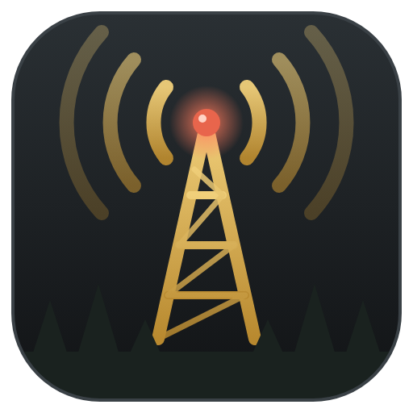
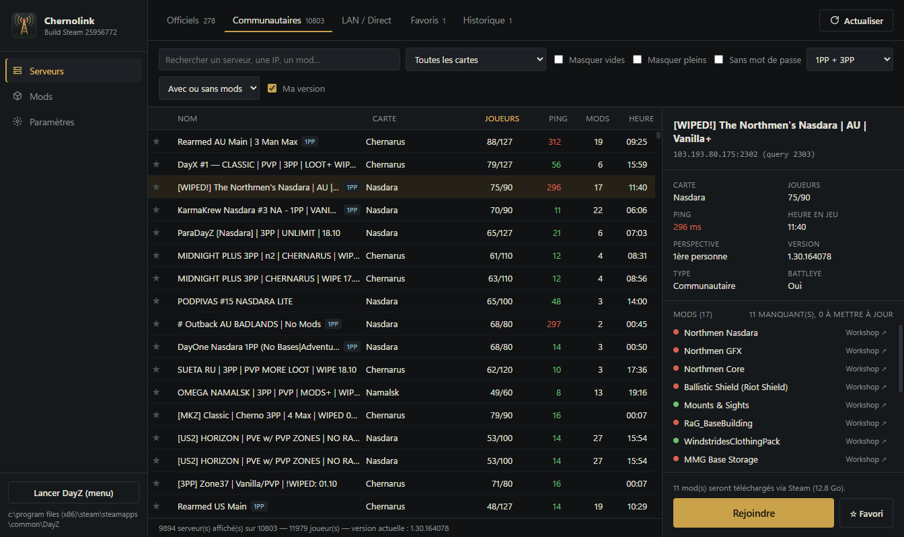
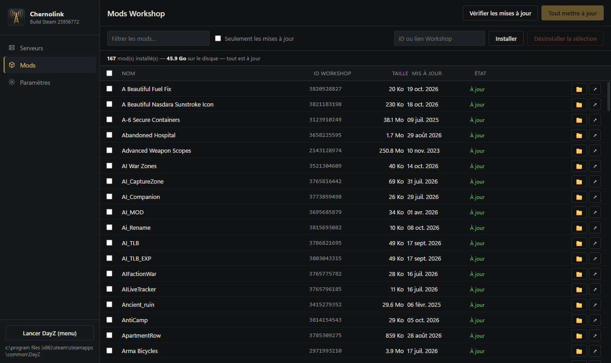

<p align="center">
  
</p>

<h1 align="center">Chernolink</h1>

<p align="center">
  Launcher Windows pour <strong>DayZ</strong> : trouvez un serveur, récupérez ses mods, jouez.
</p>

<p align="center">
  
  
  
</p>

<p align="center">
  
</p>

---

## Fonctionnalités

### Serveurs
- **Officiels, communautaires, LAN** dans des onglets séparés, plus **Favoris** et **Historique**.
- Plus de 10 000 serveurs, avec un **ping mesuré en direct** sur les lignes affichées.
- **Filtres** : carte, serveurs vides ou pleins, mot de passe, 1ère/3ème personne, vanilla ou moddé, version du jeu.
- **Recherche** par nom, adresse IP ou nom de mod.
- **Fiche détaillée** : joueurs et file d'attente, heure en jeu, perspective, version, BattlEye, et l'état de chaque mod requis (installé, à mettre à jour, manquant).
- **LAN et connexion directe** : détection automatique des serveurs du réseau local, ou ajout manuel avec `IP:port`.

### Mods
- **Rejoindre en un clic** : les mods manquants ou périmés sont téléchargés par votre client Steam, puis le jeu se lance directement sur le serveur.
- **Mises à jour** : comparaison avec le Steam Workshop, mise à jour d'un mod ou de tous d'un coup.
- **Installation** d'un mod par son ID ou son lien Workshop.
- **Nettoyage** : désinstallation, et repérage des dossiers « orphelins » restés sur le disque après un désabonnement, ou des mods retirés du Workshop.
- **Jouer sans serveur avec des mods** (DayZ-Editor, mode hors-ligne, tests) : bouton **Lancer DayZ…** ou **Jouer avec la sélection** dans l'onglet Mods. Les dépendances Workshop sont ajoutées et téléchargées automatiquement dans le bon ordre de chargement (DayZ-Editor → CF, Dabs Framework), et les sélections s'enregistrent en préréglages.

<p align="center">
  
</p>

### Paramètres
Nom du personnage, dossier de DayZ (détecté automatiquement via Steam), paramètres de lancement supplémentaires (`-cpuCount`, `-maxMem`…), BattlEye activé ou non, mise à jour automatique des mods.

## Installation

1. Téléchargez la dernière version dans les [Releases](../../releases) :
   - `Chernolink-x.y.z-setup.exe` : installateur avec raccourcis et désinstallateur ;
   - `Chernolink-x.y.z-portable.exe` : un seul fichier, sans installation.
2. Au premier lancement, Windows SmartScreen peut afficher « Windows a protégé votre ordinateur », car l'exécutable n'est pas signé. Cliquez sur **Informations complémentaires**, puis **Exécuter quand même**.

**Prérequis :** Windows 10/11 64 bits, et Steam lancé et connecté avec le compte qui possède DayZ.

## Utilisation

1. Ouvrez l'onglet **Officiels**, **Communautaires** ou **LAN / Direct**.
2. Sélectionnez un serveur : la fiche de droite indique les mods qui seront téléchargés et leur taille.
3. Cliquez sur **Rejoindre**, ou double-cliquez sur le serveur. Chernolink télécharge les mods via Steam, puis lance DayZ connecté au serveur.

> Pour ajouter un serveur à la main, indiquez son **port de requête Steam** (`steamQueryPort` dans `serverDZ.cfg`, 27016 par défaut), pas son port de jeu.

## Compiler depuis les sources

```bash
git clone <url-du-dépôt>
cd chernolink
npm install
npm start          # lance l'application en développement
npm test           # tests unitaires
npm run dist       # crée l'installateur et la version portable dans dist/
```

<details>
<summary>La compilation échoue avec « Cannot create symbolic link »</summary>

electron-builder extrait une archive d'outils qui contient deux liens symboliques destinés à macOS. Windows refuse de les créer sans privilège. Trois solutions :
- activer le **mode développeur** de Windows ;
- lancer `npm run dist` une fois dans un terminal **administrateur** ;
- extraire l'archive soi-même en ignorant ces fichiers, puis relancer la compilation :

```bash
7za x %LOCALAPPDATA%\electron-builder\Cache\winCodeSign\<fichier>.7z -o%LOCALAPPDATA%\electron-builder\Cache\winCodeSign\winCodeSign-2.6.0 -xr!*.dylib
```
</details>

## Fonctionnement

| Module | Rôle |
| --- | --- |
| [`src/core/steam.js`](src/core/steam.js) | Détecte Steam, ses bibliothèques et l'installation de DayZ (registre et `libraryfolders.vdf`). |
| [`src/core/a2s.js`](src/core/a2s.js) | Requêtes UDP Steam `A2S_INFO` / `A2S_RULES`, décodage de la liste binaire des mods DayZ, découverte LAN par broadcast. |
| [`src/core/servers.js`](src/core/servers.js) | Liste maître des serveurs, rafraîchissement et ping. |
| [`src/core/mods.js`](src/core/mods.js) | Mods installés, API publique du Workshop, jonctions `DayZ\!dzl\@<id>` et construction du paramètre `-mod=`. |
| [`src/core/workshop-worker.js`](src/core/workshop-worker.js) | Processus isolé qui pilote le client Steam via [steamworks.js](https://github.com/ceifa/steamworks.js) (abonnement, téléchargement). |
| [`src/core/launcher.js`](src/core/launcher.js) | Lance le jeu via `DayZ_BE.exe` (BattlEye) ou `DayZ_x64.exe`. |
| [`src/renderer/`](src/renderer) | Interface HTML/CSS/JS sans framework, avec une liste virtualisée pour les milliers de serveurs. |

Les paramètres, favoris et l'historique sont enregistrés dans `%APPDATA%\dayz-launcher\launcher.json`.

## FAQ

**Steam m'affiche « en train de jouer à DayZ » alors que le jeu n'est pas lancé.**
C'est normal pendant un téléchargement de mods : Chernolink utilise l'API Steamworks au nom de DayZ. Le processus concerné s'arrête 30 secondes après la fin du téléchargement.

**Mon serveur 1PP s'affiche en 1PP/3PP (ou l'inverse).**
Les serveurs DayZ annoncent le mot-clé `no3rd` quand la 3ème personne est **autorisée**, contrairement à ce que son nom suggère. Chernolink tient compte de cette inversion. Si l'affichage est faux, cliquez sur **Actualiser** après avoir redémarré le serveur.

**Pourquoi certains serveurs officiels manquent ?**
La liste provient de l'API publique de DZSA Launcher, qui ne recense qu'une partie des serveurs officiels.

**Le jeu ne se lance pas.**
Vérifiez que Steam est ouvert. Pour un serveur LAN sans BattlEye, décochez BattlEye dans les **Paramètres**.

## Remerciements

- [DZSA Launcher](https://dayzsalauncher.com) pour son API publique de liste de serveurs.
- [steamworks.js](https://github.com/ceifa/steamworks.js) pour l'accès à l'API Steamworks depuis Node.js.

## Licence

Distribué sous licence [MIT](LICENSE).

## Avertissement

Chernolink est un projet communautaire indépendant. Il n'est ni affilié à Bohemia Interactive ni approuvé par eux, pas plus que par Valve. *DayZ* est une marque de Bohemia Interactive a.s. ; *Steam* est une marque de Valve Corporation.
