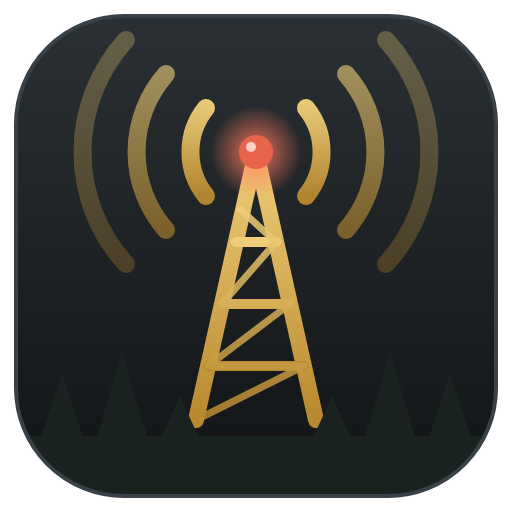
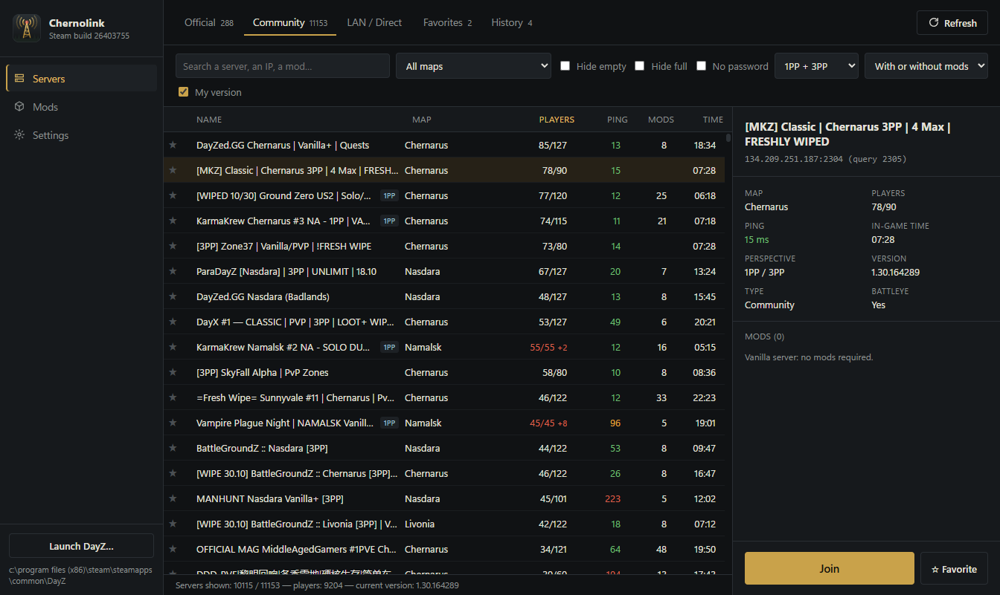
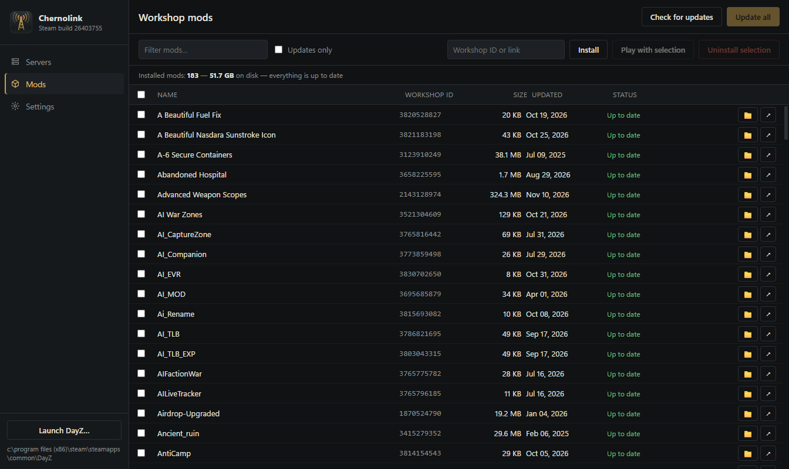

<p align="center">
  
</p>

<h1 align="center">Chernolink</h1>

<p align="center"><strong>English</strong> · <a href="README.fr.md">Français</a></p>

<p align="center">
  A Windows launcher for <strong>DayZ</strong>: find a server, get its mods, play.
</p>

<p align="center">
  
  
  
</p>

<p align="center">
  
</p>

---

## Features

### Servers
- **Official, community and LAN** servers in separate tabs, plus **Favorites** and **History**.
- Over 10,000 servers, with **live ping** for the rows on screen.
- **Filters**: map, empty or full servers, password, first/third person, vanilla or modded, game version.
- **Search** by name, IP address or mod name.
- **Server details**: players and queue, in-game time, perspective, version, BattlEye, and the status of every required mod (installed, needs update, missing).
- **LAN and direct connect**: local network servers are found automatically, or add one by `IP:port`.

### Mods
- **One-click join**: missing or outdated mods are downloaded through your Steam client, then the game starts straight on the server.
- **Updates**: compared against the Steam Workshop; update one mod or all of them at once.
- **Install** any mod from its Workshop ID or link.
- **Cleanup**: uninstall mods, and spot "orphan" folders left on disk after unsubscribing, or mods removed from the Workshop.
- **Play without a server, with mods** (DayZ-Editor, offline mode, testing): use **Launch DayZ…**, or **Play with selection** in the Mods tab. Workshop dependencies are added and downloaded automatically in the right load order (DayZ-Editor → CF, Dabs Framework), and selections can be saved as presets.

<p align="center">
  
</p>

### Settings
**Interface language**: Français, English, Deutsch, Español, Русский (defaults to your Windows language). Character name, DayZ folder (detected automatically through Steam), extra launch parameters (`-cpuCount`, `-maxMem`…), BattlEye on or off, automatic mod updates.

## Installation

1. Download the latest version from the [Releases](../../releases):
   - `Chernolink-x.y.z-setup.exe`: installer with shortcuts and an uninstaller;
   - `Chernolink-x.y.z-portable.exe`: a single file, no installation needed.
2. On first launch, Windows SmartScreen may show "Windows protected your PC" because the executable is not signed. Click **More info**, then **Run anyway**.

**Requirements:** Windows 10/11 64-bit, and Steam running and signed in with the account that owns DayZ.

## Usage

1. Open the **Official**, **Community** or **LAN / Direct** tab.
2. Select a server: the panel on the right shows which mods will be downloaded and their size.
3. Click **Join**, or double-click the server. Chernolink downloads the mods through Steam, then launches DayZ connected to the server.

> To add a server by hand, enter its **Steam query port** (`steamQueryPort` in `serverDZ.cfg`, 27016 by default), not its game port.

## Building from source

```bash
git clone https://github.com/LaurentJack/Chernolink.git
cd Chernolink
npm install
npm start          # run the app in development
npm test           # unit tests
npm run dist       # build the installer and the portable version into dist/
```

<details>
<summary>The build fails with "Cannot create symbolic link"</summary>

electron-builder extracts a tools archive that contains two symbolic links meant for macOS, and Windows refuses to create them without privileges. Three ways out:
- turn on Windows **Developer Mode**;
- run `npm run dist` once from an **administrator** terminal;
- extract the archive yourself while skipping those files, then build again:

```bash
7za x %LOCALAPPDATA%\electron-builder\Cache\winCodeSign\<file>.7z -o%LOCALAPPDATA%\electron-builder\Cache\winCodeSign\winCodeSign-2.6.0 -xr!*.dylib
```
</details>

## How it works

| Module | Role |
| --- | --- |
| [`src/core/steam.js`](src/core/steam.js) | Finds Steam, its libraries and the DayZ installation (registry and `libraryfolders.vdf`). |
| [`src/core/a2s.js`](src/core/a2s.js) | Steam UDP queries `A2S_INFO` / `A2S_RULES`, decoding of DayZ's binary mod list, LAN discovery by broadcast. |
| [`src/core/servers.js`](src/core/servers.js) | Master server list, refresh and ping. |
| [`src/core/mods.js`](src/core/mods.js) | Installed mods, public Workshop API, `DayZ\!dzl\@<id>` junctions and the `-mod=` parameter. |
| [`src/core/workshop-worker.js`](src/core/workshop-worker.js) | Isolated process that drives the Steam client through [steamworks.js](https://github.com/ceifa/steamworks.js) (subscribe, download). |
| [`src/core/launcher.js`](src/core/launcher.js) | Starts the game through `DayZ_BE.exe` (BattlEye) or `DayZ_x64.exe`. |
| [`src/locales/`](src/locales) | Translations, shared by the interface and the main process. To add a language, copy `en.js` and translate it: the tests flag any missing key or variable. |
| [`src/renderer/`](src/renderer) | Framework-free HTML/CSS/JS interface, with a virtualized list for thousands of servers. |

Settings, favorites and history are stored in `%APPDATA%\dayz-launcher\launcher.json`.

## FAQ

**Steam shows me "playing DayZ" while the game isn't running.**
That's expected during a mod download: Chernolink uses the Steamworks API on behalf of DayZ. The process involved stops 30 seconds after the download ends.

**My 1PP server shows as 1PP/3PP (or the other way round).**
The perspective comes from the DZSA list, or from querying the server directly for LAN and manually added servers. In the latter case, the `no3rd` keyword is announced when third person is **allowed**, despite its name, and Chernolink accounts for that. If the display is wrong, click **Refresh** after restarting the server.

**Why are some official servers missing?**
The list comes from the DZSA Launcher public API, which only covers part of the official servers.

**The game doesn't start.**
Make sure Steam is running. For a LAN server without BattlEye, untick BattlEye in **Settings**.

## Acknowledgements

- [DZSA Launcher](https://dayzsalauncher.com) for its public server list API.
- [steamworks.js](https://github.com/ceifa/steamworks.js) for Steamworks API access from Node.js.

## License

Released under the [MIT](LICENSE) license.

## Disclaimer

Chernolink is an independent community project. It is not affiliated with or endorsed by Bohemia Interactive or Valve. *DayZ* is a trademark of Bohemia Interactive a.s.; *Steam* is a trademark of Valve Corporation.
